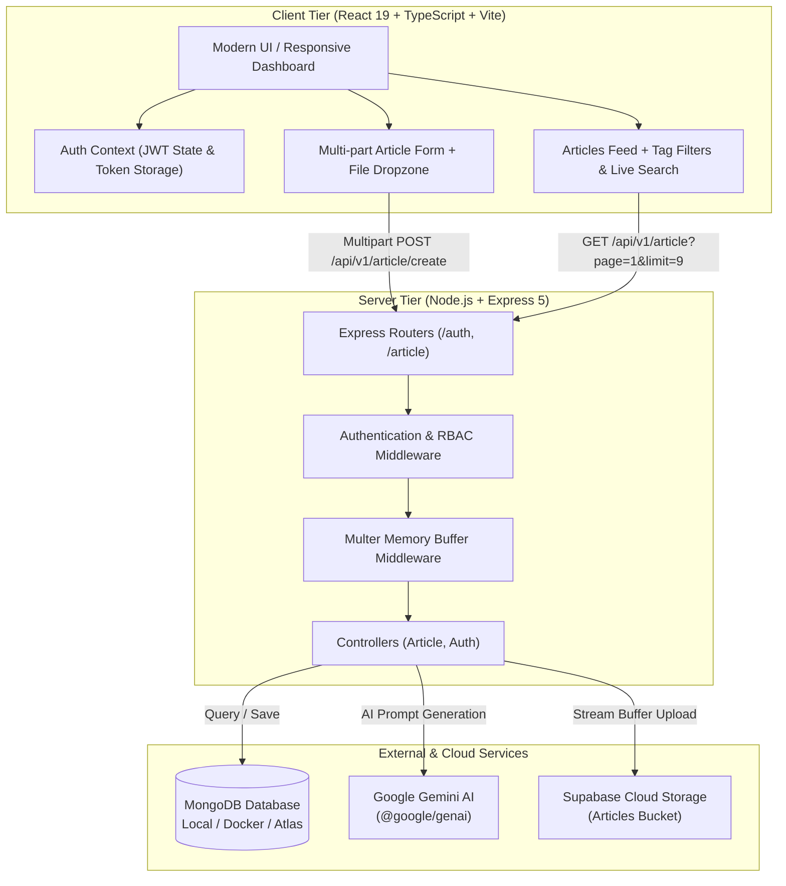

<div align="center">

# 🚀 Rapid Application Development (RAD)
### ITS2020 • Comprehensive Full-Stack Engineering Practice & Projects

[](https://github.com/chathunga2007/ITS2020-Rapid-Application-Development-Class-Practice-Projects)
[](https://www.typescriptlang.org/)
[](https://react.dev/)
[](https://nodejs.org/)
[](https://expressjs.com/)
[](https://www.mongodb.com/)
[](https://tailwindcss.com/)
[](https://ai.google.dev/)
[](https://supabase.com/)

<p align="center">
  <strong>A complete, progressive curriculum repository showcasing modern Rapid Application Development from TypeScript fundamentals to AI-integrated, cloud-backed enterprise full-stack web applications.</strong>
</p>

[📚 Curriculum Roadmap](#-curriculum-roadmap) •
[🏛️ System Architecture](#️-system-architecture) •
[📂 Project Directory](#-project-directory-structure) •
[⚡ Quick Start](#-quick-start-guide) •
[🌐 API Reference](#-rest-api-documentation) •
[💡 Highlights](#-featured-highlights--key-features)

---

</div>

## 📖 Overview

This repository contains the practical projects, hands-on lab exercises, and full-stack applications developed throughout the **Rapid Application Development (RAD)** course (ITS2020). 

The curriculum follows a structured engineering journey:
1. **Foundation**: Strong typing with TypeScript & modern ES features.
2. **Modern Frontend**: React 19 component paradigms, state management, and Tailwind CSS v4 design systems.
3. **Advanced Frontend Architecture**: Prop drilling mitigation with Context API, custom hooks, and React Router v7 with dynamic code splitting.
4. **Backend Foundations**: Express 5 REST APIs with Mongoose ODM and MongoDB persistence.
5. **Full-Stack Authentication**: MVC layered backend with bcrypt hashing, CORS, and reactive React dashboard integration.
6. **Enterprise Cloud & AI Application**: Production-ready publishing platform integrating **Google Gemini AI**, **Supabase Cloud Object Storage**, **JWT RBAC Authentication**, and responsive multi-part client dashboards.

---

## 🗺️ Curriculum Roadmap

```mermaid
flowchart LR
    W1["Week 01<br/><b>TypeScript & React Init</b>"] --> W2["Week 02<br/><b>Components & State</b>"]
    W2 --> W3["Week 03<br/><b>Context & Routing</b>"]
    W3 --> W4["Week 04<br/><b>Express 5 & MongoDB</b>"]
    W4 --> W5["Week 05<br/><b>Full-Stack Auth (Bcrypt)</b>"]
    W5 --> W6["Week 06<br/><b>AI (Gemini) + Cloud (Supabase) + JWT</b>"]

    style W1 fill:#1e293b,stroke:#3b82f6,stroke-width:2px,color:#f8fafc
    style W2 fill:#1e293b,stroke:#06b6d4,stroke-width:2px,color:#f8fafc
    style W3 fill:#1e293b,stroke:#8b5cf6,stroke-width:2px,color:#f8fafc
    style W4 fill:#1e293b,stroke:#10b981,stroke-width:2px,color:#f8fafc
    style W5 fill:#1e293b,stroke:#f59e0b,stroke-width:2px,color:#f8fafc
    style W6 fill:#1e293b,stroke:#ec4899,stroke-width:2px,color:#f8fafc
```



| Week | Core Module | Tech Stack | Highlights & Deliverables |
|:---:|:---|:---|:---|
| **01** | [TypeScript & React Bootstrapping](#week-01--typescript-fundamentals--react-bootstrap) | `Node.js`, `TypeScript`, `Vite`, `React 19` | Static typing, interfaces, generics, enums, union types, Vite SPA bootstrap |
| **02** | [React Fundamentals & Styling](#week-02--react-components-state-management--tailwind-css) | `React 19`, `Tailwind CSS v4`, `Hooks` | Class vs. functional components, props, lists & keys, `useState`, two-way binding form, Tailwind v4 setup |
| **03** | [Advanced React Architecture](#week-03--context-api-custom-hooks--react-router-v7) | `React Router DOM v7`, `Context API`, `Suspense` | Prop drilling resolution, custom hooks (`useData`), layout nesting, route-level code splitting & lazy loading |
| **04** | [Backend API & Database Basics](#week-04--node-express-5-rest-api--mongodb) | `Express 5`, `MongoDB`, `Mongoose 9`, `Node.js` | RESTful endpoints, Mongoose schema modeling, JSON body parsing, async/await error handlers |
| **05** | [Layered Architecture & Full-Stack Auth](#week-05--modular-layered-backend--full-stack-auth) | `Express 5`, `Bcrypt.js`, `CORS`, `Axios`, `React 19` | MVC pattern (controllers, routes, models), bcrypt password hashing, roles, React login/register cards & dashboard |
| **06** | [AI-Powered Article Platform](#week-06--ai-powered-cloud-publishing-platform) | `Gemini AI`, `Supabase Storage`, `JWT`, `Multer`, `Docker` | Gemini Flash text generation, Supabase bucket upload, RBAC JWT auth, multi-part form data, search & tag filter feed |

---

## 🏛️ System Architecture

The capstone architecture (Week 06) illustrates an enterprise-ready decoupled full-stack ecosystem:



---

## 📂 Project Directory Structure

```plaintext
d:\RAD\
├── Week 01/
│   ├── my-web-app/              # First React 19 + Vite + TypeScript application
│   └── Node.js/App-01/          # TypeScript language lab (types, interfaces, generics)
├── Week 02/
│   └── rad-02/                  # React components, props, useState form & Tailwind v4
├── Week 03/
│   └── web-app-week-03/         # Context API, custom hooks, React Router v7 & lazy loading
├── Week 04/
│   └── Backend-App-Week-04/     # Express 5 REST API connected to MongoDB with Mongoose
├── Week 05/
│   ├── Backend-App-Week-05/
│   │   └── be-app-02/           # Modular Express backend (Auth, Bcrypt, Roles, Item CRUD)
│   └── week-05-fe-app/          # React 19 frontend consuming auth endpoints with Axios
├── Week 06/
│   ├── rad-article-api/         # Capstone REST API: JWT RBAC, Google Gemini AI, Supabase Storage
│   └── rad-article-web/         # Capstone Web: Responsive article publishing hub & dashboard
├── .gitignore                   # Git ignore configuration
└── README.md                    # Project documentation
```

---

## 🔬 Week-by-Week Breakdown

### Week 01 • TypeScript Fundamentals & React Bootstrap
Focuses on migrating from pure JavaScript to strict typing with TypeScript, mastering modern language constructs, and initializing a blazingly fast modern Single Page Application (SPA).

* **Folder Locations**: 
  - [`Week 01/Node.js/App-01`](file:///d:/RAD/Week%2001/Node.js/App-01)
  - [`Week 01/my-web-app`](file:///d:/RAD/Week%2001/my-web-app)
* **Key Topics Covered**:
  - Primitive and Union types (`number | string`).
  - Strict interfaces and optional attributes (`email?: string`).
  - Enums (`Colors.RED`, `GREEN`, `BLUE`).
  - Generic functions (`function identity<T>(arg: T): T`).
  - TypeScript compilation workflow (`npx tsc`).
  - React 19 SPA initialization via Vite.

---

### Week 02 • React Components, State Management & Tailwind CSS
Deep-dive into component paradigms, component communication, dynamic list rendering, state mutations, and utility-first styling.

* **Folder Location**: [`Week 02/rad-02`](file:///d:/RAD/Week%2002/rad-02)
* **Key Topics Covered**:
  - **Class Components vs. Functional Components**: Lifecycle rendering vs. modern function declarations.
  - **JSX / TSX Fundamentals**: Return rules, wrapping elements, and `<Fragment>` / `<>` syntax.
  - **Props & Children**: Passing typed properties and composite child components.
  - **Dynamic Lists**: Transforming datasets using JavaScript `Array.prototype.map()` with unique keys.
  - **State with `useState`**: Counter implementation and two-way binding form (Name, Age, Email) with dynamic array state appending (`[...users, newUser]`).
  - **Tailwind CSS v4 Integration**: `@tailwindcss/vite` plugin setup and atomic styling.

---

### Week 03 • Context API, Custom Hooks & React Router v7
Solving state synchronization challenges in large component trees and establishing scalable client-side navigation.

* **Folder Location**: [`Week 03/web-app-week-03`](file:///d:/RAD/Week%2003/web-app-week-03)
* **Key Topics Covered**:
  - **Prop Drilling Problem**: Resolving multi-level parameter passing (`CompA` → `CompB` → `CompC` → `CompD`).
  - **React Context API**: Creating providers and consumers (`DataContext.Provider`).
  - **Custom Hook Encapsulation**: Building `useData()` with runtime context validation.
  - **React Router DOM v7**:
    - Declarative routing with `<BrowserRouter>`, `<Routes>`, `<Route>`.
    - Nested Layouts with `<Outlet />` (`DashboardLayout`, `AuthDashboard`).
    - Page-level code splitting using `React.lazy()` and `<Suspense fallback={<Loading />} />`.

---

### Week 04 • Node, Express 5 REST API & MongoDB
Building a reliable backend service with asynchronous handlers and document database integration.

* **Folder Location**: [`Week 04/Backend-App-Week-04`](file:///d:/RAD/Week%2004/Backend-App-Week-04)
* **Key Topics Covered**:
  - Node.js runtime execution with `--watch` and `--experimental-strip-types`.
  - Express.js v5 application setup.
  - Body parser middleware (`express.json()`).
  - MongoDB connection lifecycle via Mongoose ODM.
  - Typed Schema and Model declaration (`ItemModel`).
  - REST API design (`POST /api/v1/item`, `GET /api/v1/item`) with standard JSON envelopes and status codes (200, 201, 500).

---

### Week 05 • Modular Layered Backend & Full-Stack Auth
Transitioning to clean code architecture with Controller-Route-Model separation, cryptographic security, and a connected frontend client.

* **Folder Locations**: 
  - Backend: [`Week 05/Backend-App-Week-05/be-app-02`](file:///d:/RAD/Week%2005/Backend-App-Week-05/be-app-02)
  - Frontend: [`Week 05/week-05-fe-app`](file:///d:/RAD/Week%2005/week-05-fe-app)
* **Key Topics Covered**:
  - **Layered Architecture**: Decoupling routing logic (`routes/`), business controllers (`controllers/`), and persistence schemas (`models/`).
  - **Password Security**: One-way salt hashing using `bcryptjs` (`genSaltSync`, `hashSync`, `compareSync`).
  - **Role-Based Profiles**: Handling user roles (`USER`, `ADMIN`) and account approval flags (`approve`).
  - **CORS Handling**: Cross-Origin Resource Sharing configuration between backend and frontend dev servers.
  - **Frontend Auth Integration**:
    - Dual mode Auth Card (toggle between Sign In and Sign Up).
    - Persistent session state backed by `localStorage` (`rad_auth_user`).
    - Authenticated user Dashboard displaying user role badges and one-click session logout.

---

### Week 06 • AI-Powered Cloud Publishing Platform
A flagship, production-grade full-stack web application integrating artificial intelligence, cloud object storage, and secure tokenized authentication.

* **Folder Locations**:
  - Backend: [`Week 06/rad-article-api`](file:///d:/RAD/Week%2006/rad-article-api)
  - Frontend: [`Week 06/rad-article-web`](file:///d:/RAD/Week%2006/rad-article-web)
* **Key Topics Covered**:
  - **Google Gemini Generative AI**: Integrating `@google/genai` (Flash model) to synthesize intelligent descriptions and article summaries on demand.
  - **Cloud Object Storage (Supabase)**: Streaming file uploads with Multer memory storage directly to Supabase Storage buckets, with automatic base64 fallback.
  - **JWT RBAC Authentication**: Cryptographic token signing with Access and Refresh tokens, bearer token verification middleware, and granular role guard middleware (`requireRole([UserRole.ADMIN, UserRole.WRITTER])`).
  - **DNS Resolution Engine**: Built-in Google DNS resolution fallback (`dns.setServers(["8.8.8.8"])`) ensuring resilient MongoDB connection stability across diverse network environments.
  - **Containerization**: Ready-to-run `docker-compose.yml` for isolated MongoDB 7.0 instances.
  - **Modern Publishing UI**:
    - Interactive Hero banner and Quick Post inline drawer.
    - Full-page Create Article Studio with drag-and-drop cover upload & live preview.
    - Real-time client-side keyword search & dynamic topic filter chips (`#react`, `#nodejs`, etc.).
    - Double-submission guard preventing accidental duplicate requests.
    - Fully responsive paginated card grid.

---

## 🌐 REST API Documentation

### 1. Week 06 • Article Platform API (`rad-article-api`)
Base URL: `http://localhost:3000/api/v1`

| Method | Endpoint | Auth Required | Roles | Description |
|:---:|:---|:---:|:---:|:---|
| `POST` | `/auth/register` | No | Any | Register a new account with hashed password |
| `POST` | `/auth/login` | No | Any | Authenticate and obtain JWT Access & Refresh tokens |
| `POST` | `/auth/refresh` | No | Any | Renew an expired Access Token using a valid Refresh Token |
| `GET` | `/auth/me` | **Yes** | Any | Retrieve the current authenticated user profile |
| `GET` | `/article` | No | Public | Paginated list of visible articles (`?page=1&limit=9`) |
| `GET` | `/article/:id` | No | Public | Retrieve detailed information for a single article |
| `POST` | `/article/create` | **Yes** | `ADMIN`, `WRITTER`, `USER` | Publish new article with multi-part cover upload & tags |
| `POST` | `/article/ai` | No | Public | Auto-generate article description using Google Gemini AI |
| `PATCH`| `/article/:id/visibility`| **Yes** | `ADMIN` | Toggle article public visibility flag |
| `PATCH`| `/article/:id/favorite`| **Yes** | Any | Toggle article bookmark/favorite for the user |

#### Example: Publish Article Request (`multipart/form-data`)
```http
POST /api/v1/article/create HTTP/1.1
Host: localhost:3000
Authorization: Bearer <YOUR_ACCESS_TOKEN>
Content-Type: multipart/form-data; boundary=----WebKitFormBoundary7MA4YWxkTrZu0gW

------WebKitFormBoundary7MA4YWxkTrZu0gW
Content-Disposition: form-data; name="title"

Deep Dive into React 19 Features
------WebKitFormBoundary7MA4YWxkTrZu0gW
Content-Disposition: form-data; name="content"

An in-depth guide exploring React Server Components, Actions, and enhanced hooks...
------WebKitFormBoundary7MA4YWxkTrZu0gW
Content-Disposition: form-data; name="tags"

react, frontend, javascript
------WebKitFormBoundary7MA4YWxkTrZu0gW
Content-Disposition: form-data; name="image"; filename="cover.png"
Content-Type: image/png

<binary data>
------WebKitFormBoundary7MA4YWxkTrZu0gW--
```

---

### 2. Week 05 • Auth & Item API (`be-app-02`)
Base URL: `http://localhost:3000/api/v1`

| Method | Endpoint | Description |
|:---:|:---|:---|
| `POST` | `/auth/register` | Register user with email, username, roles, and password |
| `POST` | `/auth/login` | Validate credentials and return user profile |
| `POST` | `/item` | Create a new catalog item |
| `GET` | `/item` | Retrieve all catalog items |

---

### 3. Week 04 • Starter Item API (`Backend-App-Week-04`)
Base URL: `http://localhost:3000/api/v1`

| Method | Endpoint | Description |
|:---:|:---|:---|
| `POST` | `/item` | Insert new item (`{ "name": "Laptop", "price": 1200 }`) |
| `GET` | `/item` | Fetch all stored items from MongoDB |

---

## ⚡ Quick Start Guide

### Prerequisites
* **Node.js** (v20+ recommended)
* **npm** or **pnpm**
* **MongoDB** (Local instance or running via Docker)
* *(Optional)* **Supabase Account** and **Google Gemini API Key** for Week 06 cloud features.

---

### Running the Capstone Project (Week 06)

#### 1. Start MongoDB with Docker
```bash
cd "Week 06/rad-article-api"
docker compose up -d
```

#### 2. Configure Environment Variables
Create a `.env` file inside `Week 06/rad-article-api/`:
```env
PORT=3000
MONGO_LOCAL_URL=mongodb://localhost:27017/rad_article_db
JWT_SECRET=super_secret_jwt_access_key_123456
JWT_REFRESH_SECRET=super_secret_jwt_refresh_key_123456
SUPABASE_URL=https://your-project.supabase.co
SUPABASE_KEY=your-supabase-service-or-anon-key
GEMINI_API_KEY=your-google-gemini-api-key
```

#### 3. Start the Backend API
```bash
cd "Week 06/rad-article-api"
npm install
npm run dev
# Server will run on http://localhost:3000
```

#### 4. Start the Frontend Client
```bash
cd "Week 06/rad-article-web"
npm install
npm run dev
# Vite dev server will launch at http://localhost:5173
```

---

### Running Other Weekly Projects

#### Week 01: TypeScript Lab & Web App
```bash
# TypeScript compiler execution
cd "Week 01/Node.js/App-01"
npm install
npx tsc app.ts
node app.js

# React Vite App
cd "Week 01/my-web-app"
npm install
npm run dev
```

#### Week 02: React Components & State
```bash
cd "Week 02/rad-02"
npm install
npm run dev
```

#### Week 03: Context API & Routing
```bash
cd "Week 03/web-app-week-03"
npm install
npm run dev
```

#### Week 04: Express & MongoDB Starter
```bash
cd "Week 04/Backend-App-Week-04"
npm install
npm run dev
```

#### Week 05: Layered Full-Stack Auth App
```bash
# Backend
cd "Week 05/Backend-App-Week-05/be-app-02"
npm install
npm run dev

# Frontend
cd "Week 05/week-05-fe-app"
npm install
npm run dev
```

---

## 💡 Featured Highlights & Key Features

### 1. Google Gemini AI Description Engine
Integrated with the new Google GenAI SDK (`@google/genai`), enabling automatic generation of engaging descriptions based on article titles:
```typescript
import { GoogleGenAI } from "@google/genai"

const ai = new GoogleGenAI({ apiKey: process.env.GEMINI_API_KEY })

export const genrateArticleDescription = async (promptText: string) => {
  const res = await ai.models.generateContent({
    model: "gemini-3.5-flash-lite",
    contents: `What is ${promptText}`,
    config: { maxOutputTokens: 500 }
  })
  return res.text
}
```

### 2. Dual-Engine Image Upload (Supabase + Base64 Fallback)
Ensures zero upload disruptions by saving file buffers directly to Supabase cloud buckets, with a transparent fallback to data URIs if cloud storage credentials are not provided:
```typescript
const { error } = await supabase.storage
  .from("articles")
  .upload(fileName, file.buffer, { contentType: file.mimetype })

if (error) {
  // Graceful fallback for local development
  return `data:${file.mimetype};base64,${file.buffer.toString("base64")}`
}
```

### 3. Resilient Network & DNS Configuration
Pre-configured Google DNS resolvers to bypass local network DNS resolution hurdles when connecting to remote cloud MongoDB Atlas clusters:
```typescript
import dns from "node:dns"
dns.setServers(["8.8.8.8"])
```

### 4. Enterprise RBAC Middleware
Declarative role-based route protection ensuring strict privilege boundaries across admins, writers, and general users:
```typescript
router.post(
  "/create",
  authenticate,
  requireRole([UserRole.ADMIN, UserRole.WRITTER, UserRole.USER]),
  upload.single("image"),
  createArticle
)
```

---

## 🛠️ Technology Stack Matrix

| Domain | Technologies & Libraries |
|:---|:---|
| **Frontend Frameworks** | React 19, TypeScript, Vite |
| **Routing & Navigation** | React Router DOM v7 (Data & Nested Routers) |
| **Styling & Design** | Tailwind CSS v4, Glassmorphism, CSS Custom Properties |
| **State & Data Fetching** | React Context API, Custom Hooks, Axios |
| **Backend & Runtime** | Node.js (ES Modules), Express.js 5 |
| **Database & ODM** | MongoDB 7.0, Mongoose 9 |
| **Authentication & Security** | JWT (jsonwebtoken), Bcrypt.js, RBAC Middleware, CORS |
| **AI & Machine Learning** | Google Gemini Generative AI (`@google/genai`) |
| **Cloud Object Storage** | Supabase Storage (`@supabase/supabase-js`), Multer |
| **DevOps & Tooling** | Docker, Docker Compose, ESLint 10, tsx, Git |

---

## 👨‍💻 Author

* **Chathunga Bimsara**
  - **GitHub**: [@chathunga2007](https://github.com/chathunga2007)
  - **Email**: [wggachathungabimsara2007@gmail.com](mailto:wggachathungabimsara2007@gmail.com)
  - **Batch**: ITS2020 • Rapid Application Development (RAD)

---

## 📜 License

This project is licensed under the [ISC License](https://opensource.org/licenses/ISC). Feel free to use this repository as a learning reference for modern full-stack application development.

<div align="center">
  <sub>Built with ❤️ by Chathunga Bimsara for ITS2020 Rapid Application Development.</sub>
</div>
